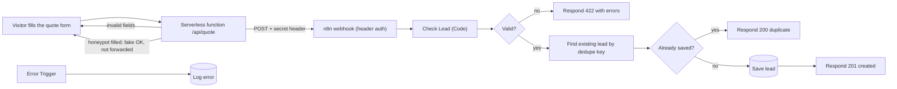

# Case Study: Website Quote Form to n8n Lead Intake

**A website quote form posts to a serverless function that checks the request and forwards it to an n8n webhook with a secret header. n8n checks it again, skips repeat submissions, saves the lead and replies with a status the page shows to the visitor.**

   

| | |
|---|---|
| **Type** | Portfolio build (reference implementation, not a client engagement) |
| **My role** | Sole designer and builder: form and client-side handling, serverless function, webhook security, n8n validation and dedupe, tests |
| **Scale** | 1 n8n workflow, 11 nodes; 1 serverless function; 2 data tables (leads, errors) |
| **Stack** | Netlify (static hosting + Functions), n8n (Webhook with header auth, Code, If, Data table, Respond to Webhook, Error Trigger), Node.js test runner |
| **Status** | Deployed and tested end to end on labelled synthetic leads (results below). Not used by a real business. |
| **Results** | 6 of 6 hosted API checks, 2 of 2 real page submits, 8 of 8 unit tests (synthetic data) |

---

## The problem

A small home-services business gets quote requests from its website. A plain form that emails the owner loses leads in the inbox, saves the same person twice when they click "send" again, and lets spam bots fill the list. Pointing the form straight at an automation webhook is worse: the webhook URL sits in the page source, so anyone can post to it.

## Outcome

- The browser never sees the webhook address or the secret. Only the serverless function knows them.
- Every request is checked twice: once in the function (with friendly per-field messages) and again in n8n, which never trusts the caller.
- Phone numbers are stored in one format (`+1XXXXXXXXXX`), so the same person typed two ways is still one lead.
- A repeat submission returns "we already have your request" and adds no row.
- Bot submissions that fill a hidden field get a normal-looking reply and are never forwarded.
- A request without the right secret header is refused by n8n (403).
- Any failure inside the workflow is logged to an errors table, and the visitor sees "please call us instead" rather than a blank error.
- Tested end to end on the deployed site: 6 of 6 API checks and 2 of 2 real page submits behaved as designed.

---

## Architecture



### Stage by stage

| # | Stage | What it does | Why it is built this way |
|---|---|---|---|
| 1 | Form (`site/index.html`) | Collects name, phone, ZIP, service, best time, optional email and message; sends JSON to `/api/quote`; shows field errors or a thank-you | No framework and no build step, so it deploys as a static file |
| 2 | Serverless function (`netlify/functions/submit-lead.mjs`) | Rejects non-POST and bad JSON, validates and normalises fields, drops honeypot hits, adds `source` and `submitted_at`, forwards with the secret header and an 8 s timeout | Keeps the webhook URL and secret server-side; gives the visitor specific messages without a round trip to n8n |
| 3 | Webhook (header auth) | Accepts only requests carrying the right `x-intake-token` value | A leaked URL alone is useless |
| 4 | Check Lead (Code) | Re-validates every field, checks the dedupe key matches the phone and email, flags labelled test data | The workflow can be called by something other than this function; it must not trust its input |
| 5 | Find Existing Lead + Already Saved? | Looks up the dedupe key (`phone|email`) | Double clicks and repeat visits do not create duplicate leads |
| 6 | Save Lead + Respond | Inserts the row and returns `created` with a lead ID, or `duplicate`, or `invalid` with the failing fields | The function and the page can tell the visitor exactly what happened |
| 7 | Error Trigger + Log Error | Records the execution ID, failing node and message | Failures leave a trail without a second workflow |

---

## Deep dives

### Two layers of validation

`lib/lead.mjs` is shared by the function and the unit tests. It trims and caps every field, lowercases email, accepts US/Canada numbers in any common format (`(555) 201-0101`, `1 555 201 0101`) and rejects area codes starting with 0 or 1. It returns either a clean lead or a map of field to message, which the page shows under each input.

The n8n Code node repeats the checks on the already-clean data with stricter rules (phone must already be `+1` and 10 digits, the dedupe key must equal `phone|email`). If anything reaches the webhook without going through the function, it is rejected with 422.

### Dedupe key

The key is `+1XXXXXXXXXX|email` (or `|-` with no email). Because the phone is normalised first, `555-201-0505` and `(555) 201-0505` with `TEST05@example.com` and `test05@example.com` are the same lead.

### Status codes the function returns

| Situation | Code | What the visitor sees |
|---|---|---|
| Saved or already saved | 200 | Thank-you or "we already have your request" |
| Honeypot filled | 200 | Thank-you (nothing forwarded) |
| Bad fields | 422 | A message under each field |
| Not JSON / not POST | 400 / 405 | Short error |
| n8n refused (wrong secret, workflow error) | 502 | "We could not save your request. Please call us instead." |
| n8n unreachable or slow (over 8 s) | 504 | Same message |
| Function missing its settings | 500 | "Intake is not configured." |

---

## Decision log

### Decision 1: a serverless function in front of the webhook
- **Options:** form posts straight to n8n; form posts to a function that forwards.
- **Chose:** the function.
- **Cost or safeguard:** one more hop (about 2 seconds from function to saved row in the hosted test), in exchange for a hidden URL and secret, friendly errors and spam filtering before n8n runs.

### Decision 2: a shared-secret header, not a signed payload
- **Options:** header auth; HMAC signature over the body.
- **Chose:** header auth, which n8n's webhook supports natively with a stored credential.
- **Cost or safeguard:** the secret lives only in the function's environment variables and in the n8n credential. Rotate both together.

### Decision 3: n8n Data tables for storage
- **Options:** a spreadsheet, a CRM, n8n's built-in Data tables.
- **Chose:** Data tables: no extra account or credential, and lookups by key are one node.
- **Cost or safeguard:** swap the two Data table nodes for a CRM or sheet node to send leads elsewhere (see Configuration).

### Decision 4: error handling inside the same workflow
- **Options:** a separate error workflow; an Error Trigger in this one.
- **Chose:** the Error Trigger in the same workflow, so the project stays one importable file.

---

## Failure modes I designed for

| What goes wrong | What happens |
|---|---|
| Visitor mistypes a field | 422 with a message under that field; nothing forwarded |
| Visitor clicks send twice | Second request returns `duplicate`; one row |
| Bot fills the hidden field | Fake 200; nothing forwarded or saved |
| Someone finds the webhook URL | 403 without the secret header |
| Someone posts to the webhook with the secret but bad data | 422 from n8n's own checks |
| A node fails inside the workflow | Error logged to the errors table; visitor told to call (502) |
| n8n is down or slow | Function gives up after 8 s; visitor told to call (504) |
| Function deployed without its settings | 500 "Intake is not configured", before any forwarding |

## Data model

| Table | Purpose / fields used |
|---|---|
| Leads | `dedupe_key`, `name`, `phone`, `email`, `zip`, `service`, `preferred_time`, `message`, `source`, `submitted_at`, `is_test` |
| Errors | `execution_id`, `failed_node`, `error_message`, `failed_at` |

## Testing and verification

**How it was tested.** All data is synthetic and labelled (`Test Lead NN`, `@example.com`, 555 numbers); the workflow flags these rows `is_test`. Expected outcomes were written before each request. Four separate runs, each run once, on the deployed n8n instance and the deployed site.

**Run 1: unit tests** (`npm test`, Node.js test runner, fetch mocked)

| Measure | Result |
|---|---|
| Validation, phone format, honeypot, status mapping, timeout handling | 8 of 8 pass |

**Run 2: pinned workflow paths** (n8n test runs with pin data)

| Measure | Result |
|---|---|
| New lead saved, duplicate detected, invalid rejected, error logged | 4 of 4 paths correct |

**Run 3: deployed site, public URL** (curl to `/api/quote`, then the page's own submit script)

| Measure | Result |
|---|---|
| API checks: new lead (created), duplicate, invalid (4 field errors), honeypot (not saved), bad JSON (400), GET (405) | 6 of 6 as expected |
| Real page submits: valid lead shows thank-you and is saved; invalid shows 4 field messages | 2 of 2 as expected |
| Function to saved row | about 2 seconds |
| Rows in the leads table after the run | only the labelled valid leads; no spam or invalid rows |

**Secret check.** A request to the webhook with a wrong secret returned 403, and the function turned it into the 502 "please call us" message.

### What did not go perfectly
- **Hosted URL blocked at first.** The new site had the host's visitor password protection switched on, so the first hosted run got 401 for every request. Turning it off in the site's access settings fixed it. Check this setting on a fresh deploy.
- **Duplicate check is look-up-then-insert.** Two identical submissions arriving in the same instant could both pass the look-up. Not seen in testing; a unique key on the table or a CRM upsert closes it.
- **Scope.** Synthetic leads, single runs, one tester: proof the paths work, not production volume.

## Configuration and swap-ins

Everything below is a setting or a node swap, not a rewrite.

| What | Default here | Change it to |
|---|---|---|
| Host | Netlify (static site + Functions) | Any host with serverless functions; keep the handler, change the export signature |
| Storage | n8n Data tables | Google Sheets, Airtable or a CRM node in place of Find Existing Lead and Save Lead |
| Service list | 5 HVAC services | Edit `SERVICE_TYPES` in `lib/lead.mjs`, the form's `<select>` and the list in Check Lead |
| Phone rule | US/Canada 10-digit | Change `normalizePhone` and the Check Lead regex |
| Secret header | `x-intake-token` | Any header name; set it in the function and the n8n credential |
| Timeout | 8 s | `AbortSignal.timeout` in the function |
| Notifications | none | Add an email, chat or SMS node after Save Lead |

## Skills used

- **Serverless functions:** request handling, environment variables, timeouts, status mapping.
- **Webhook security:** header auth credential, secret kept server-side, honeypot spam filter.
- **n8n workflow design:** Code validation, If branching, Data table look-up and insert, Respond to Webhook, Error Trigger.
- **Data quality:** phone normalisation, dedupe key, test-data flag.
- **Testing:** unit tests with mocked fetch, pinned n8n paths, end-to-end checks on the deployed site.

## Repository

| File | Purpose |
|---|---|
| `site/index.html` | Quote form and its submit script |
| `netlify/functions/submit-lead.mjs` | Serverless function at `/api/quote` |
| `lib/lead.mjs` | Shared validation and normalisation |
| `tests/lead.test.mjs` | Unit tests |
| `workflows/netlify-lead-intake.json` | n8n workflow export (inactive) |
| `samples/quote-request.json` | Sample form payload |
| `netlify.toml` | Publish and functions folders |
| `.env.example` | The two settings the function needs |

### Run it yourself

1. In n8n, create two Data tables with the columns in Data model, import `workflows/netlify-lead-intake.json`, and replace `YOUR_LEADS_TABLE_ID` and `YOUR_ERRORS_TABLE_ID` in the three Data table nodes.
2. Create a Header Auth credential (header name `x-intake-token`, value a long random string, for example `openssl rand -hex 32`), select it on the webhook node, and publish the workflow.
3. Run the tests: `npm test`.
4. Deploy the site and set `N8N_WEBHOOK_URL` (your production webhook URL) and `N8N_INTAKE_TOKEN` (the same random string) as environment variables, then redeploy.
5. Try it:

```bash
curl -X POST https://YOUR_SITE/api/quote \
  -H 'content-type: application/json' \
  -d @samples/quote-request.json
```

The company, people and phone numbers are fictional demo data. MIT licensed.
